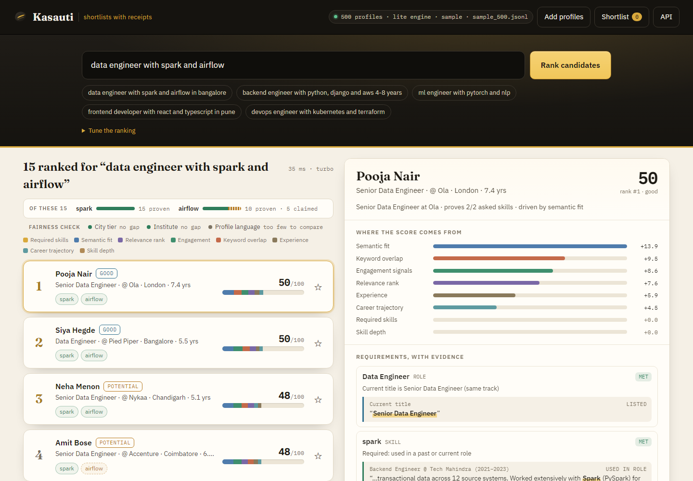
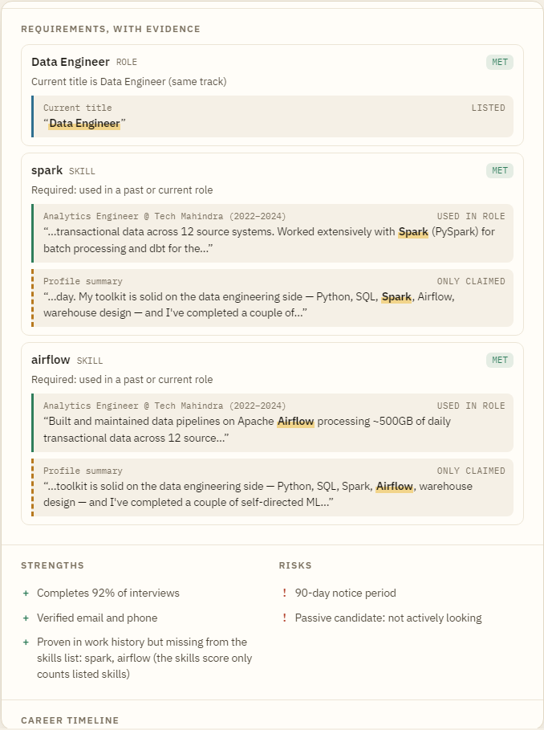
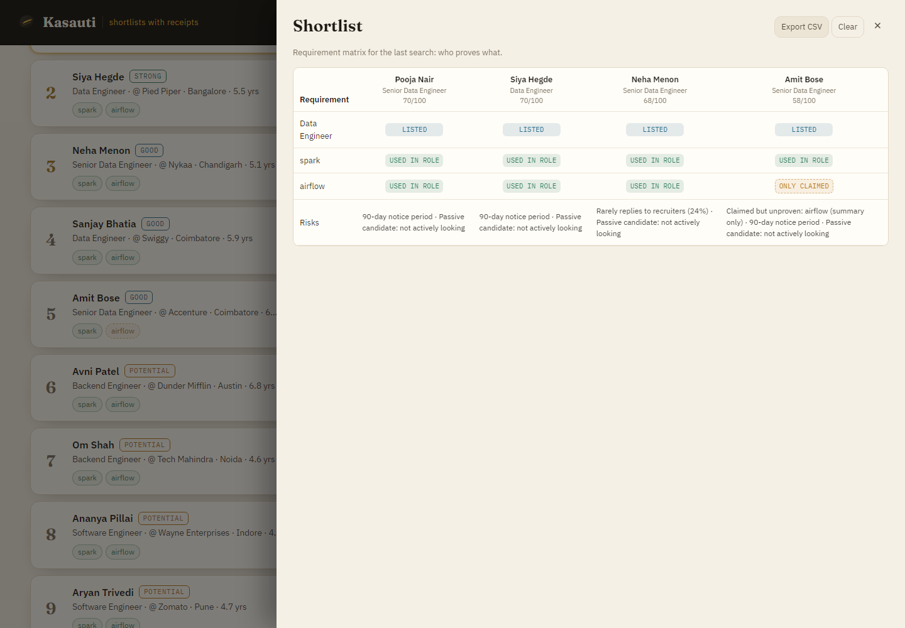
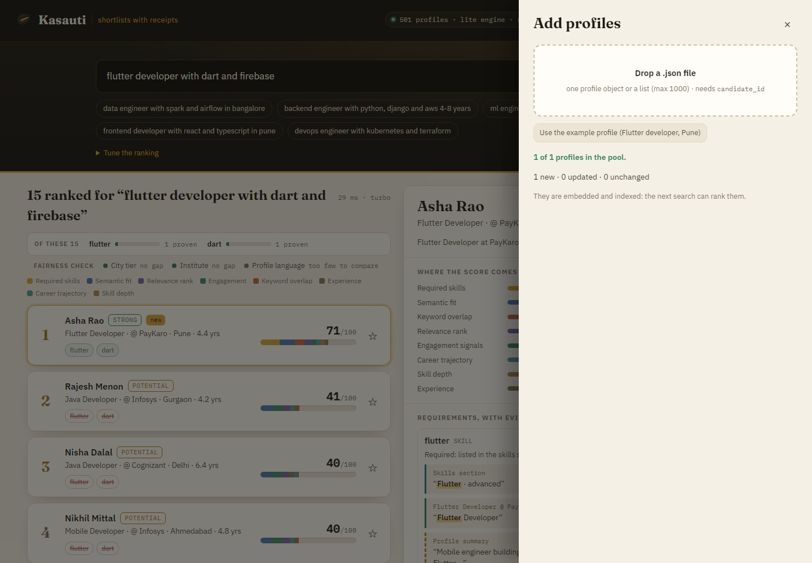
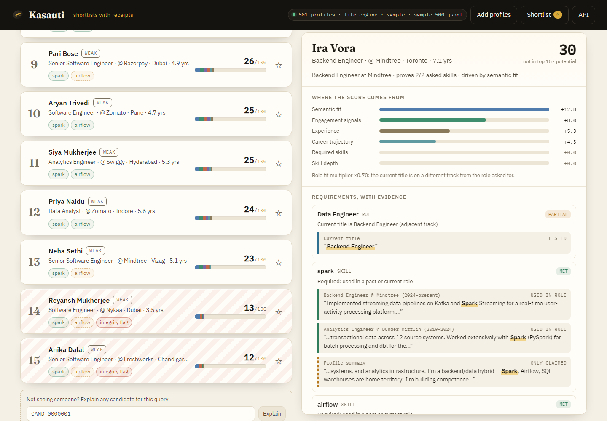
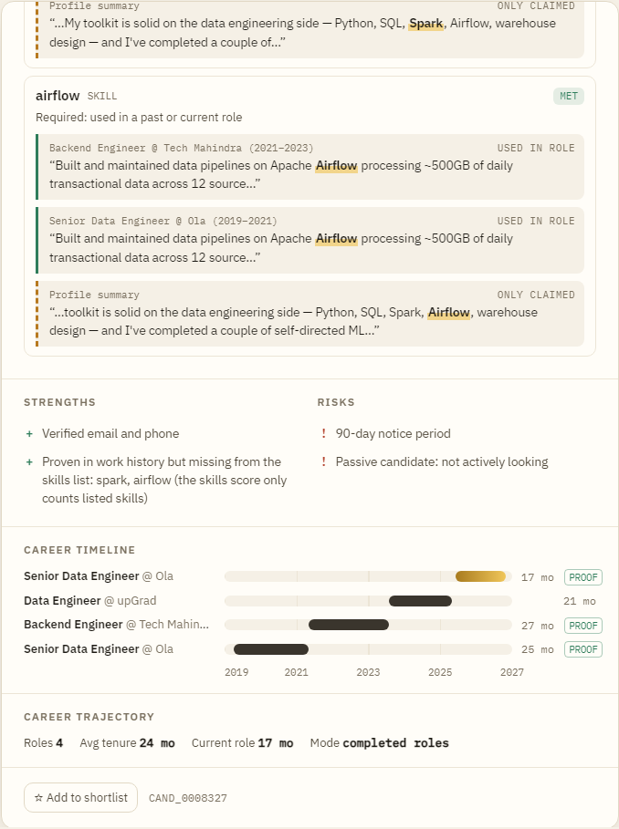
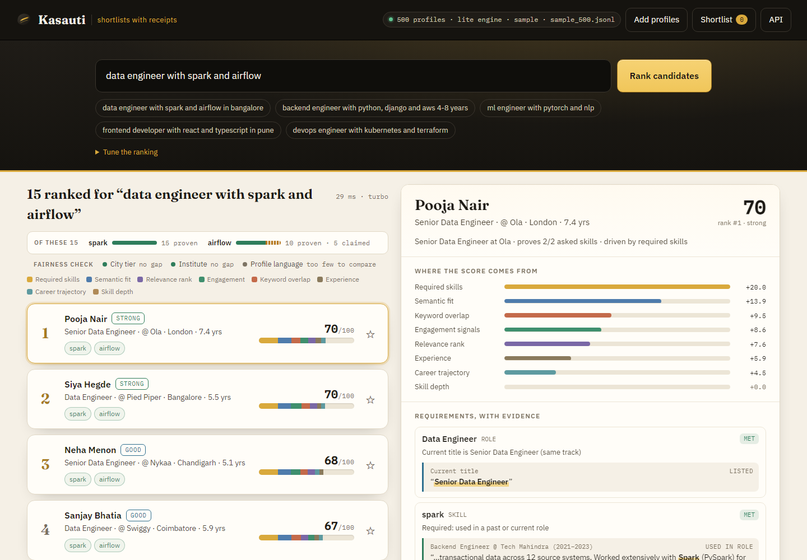

<p align="center"></p>

<h1 align="center">Kasauti</h1>
<p align="center"><b>Evidence-backed candidate ranking. Shortlists you can defend.</b></p>
<p align="center">
Rank a talent pool against a role written in plain English. Every result carries its receipt:<br>
where the score came from, and the exact sentence that proves (or only claims) each requirement.
</p>



> *Kasauti* (कसौटी) is the touchstone a jeweller rubs gold against to test it. This project
> began as **India Runs**, a Track 1 entry for the Redrob AI hackathon; the repo keeps that name.

---

## Why

Keyword filters reward whoever fills in the skills box, and AI matchers return a number nobody
can audit. In the bundled sample, *none* of the top 5 results for "data engineer with spark and
airflow" lists either skill in the skills section, yet every one of them shows both in their work
history. Kasauti finds them, and shows you why, quote by quote.

| | |
|---|---|
| **Score receipt** | The rank bar *is* the score. Each coloured segment is one signal's points (skills, semantic fit, engagement, keyword overlap, experience, trajectory, …), and the points add up to the number shown. A role-fit multiplier, when applied, is spelled out. |
| **Claims vs proof** | Every skill, role, city and years band in the query is checked and graded **verified** (platform assessment) · **listed** (skills section) · **used in a role** (a real job's title or description) · **only claimed** (summary text) · **missing**. The quoted sentence comes with the match highlighted. |
| **Risks up front** | Integrity flags (impossible timelines, skill-density anomalies), 90-day notice periods, low recruiter response rates, short stints, passive candidates, and skills that are claimed but unproven. |
| **Why not them?** | Type any profile ID to score and explain it against the same query, even if it is not on the list. Each candidate's career timeline marks the roles that hold proof. |
| **Fairness check** | Every result list is checked for score gaps by city tier, institute (IIT/NIT/BITS vs the rest) and profile language. It reports and never silently re-ranks. |
| **Shortlist matrix** | Star candidates to get a requirement × candidate matrix (who proves what), then export it to CSV with the reasoning attached. |
| **Live talent pool** | Drop a JSON file: profiles are validated, persisted, embedded and indexed, so the next search ranks them. Re-uploads are idempotent (`created` / `updated` / `unchanged`). |
| **Runs anywhere** | The lite engine needs no model, no GPU and no API key: ~0.3 GB RAM, 4 s cold start, 20–60 ms per search on 500 profiles. Switch to the transformer + cross-encoder + LLM-agent stack with one build arg. |

<table>
<tr>
<td width="50%"></td>
<td width="50%"><br><br></td>
</tr>
<tr>
<td width="50%"></td>
<td width="50%"></td>
</tr>
</table>

## Quick start

**Docker (lite engine, one command):**

```bash
docker compose up --build        # → http://localhost:7860
```

**Local Python 3.11+:**

```bash
python -m venv .venv && source .venv/bin/activate      # Windows: .venv\Scripts\activate
pip install -r requirements-lite.txt && pip install --no-deps -e .
EMBEDDING_BACKEND=hashing CROSS_ENCODER_ENABLED=false uvicorn src.main:app --port 7860
# open http://localhost:7860   (API docs: /docs)
```

With no index on disk, the server indexes `data/samples/sample_500.jsonl` in memory at startup,
so it is useful immediately. For the full stack (multilingual embeddings, cross-encoder, LangGraph
agents), run `pip install -e .`, build indexes with `python scripts/build_indexes.py --sample 500`,
and start without the two env vars (`docker build --build-arg ENGINE=full .` does the same). All
settings are listed in [`.env.example`](.env.example).

A five-minute walkthrough for a live demo is in [docs/DEMO.md](docs/DEMO.md).

## API

| Endpoint | Method | What it does |
|---|---|---|
| `/api/v1/search` | POST | Rank the pool for a query. Each result includes `explanation` (contributions, requirements with evidence spans, strengths, risks, trajectory). |
| `/api/v1/explain` | POST | Score and explain **one** profile for a query, even one that did not make the list ("why isn't X ranked?"). |
| `/api/v1/fairness` | POST | Score-gap check over a ranked list (`items: [{profile_id, score}]`): city tier, institute, language. |
| `/api/v1/ingest` | POST | Upload `.json` (one profile or a list, ≤1000): validate → persist → embed → index. Idempotent by `candidate_id`. |
| `/api/v1/profiles`, `/api/v1/profiles/{id}` | GET | Browse the pool / fetch one normalised profile. |
| `/api/v1/health` | GET | Index size, engine mode (`sample` / `index`), embedding backend, model status. |

```bash
curl -s localhost:7860/api/v1/search -H 'content-type: application/json' -d '{
  "query": "data engineer with spark and airflow in bangalore",
  "max_results": 5,
  "skill_evidence": "work_history",
  "trajectory_mode": "completed_roles"
}' | jq '.results[0].explanation.requirements[1]'
```

```json
{
  "requirement": "spark", "kind": "skill", "status": "met", "strength": "demonstrated",
  "detail": "Required: used in a past or current role",
  "evidence": [{
    "source": "experience", "label": "Analytics Engineer @ Tech Mahindra (2022–2024)",
    "text": "…transactional data across 12 source systems. Worked extensively with Spark (PySpark) for batch processing…",
    "start": 70, "end": 75, "strength": "demonstrated"
  }]
}
```

**Ranking options.** Both default to the ranking the project has always produced:

| Field | Default | Alternative |
|---|---|---|
| `skill_evidence` | `listed`: the skills score counts the skills section only | `work_history`: skills proven in a role or an assessment also count (summary-only claims never do). In the sample, the top data engineers move from *potential* (0.50) to *strong* (0.70). |
| `trajectory_mode` | `completed_roles`: job stability is measured on finished roles | `include_current`: the open role's tenure counts too, so a long current job is no longer ignored |
| `slider_weights` | config weights | `skill_match`, `experience_match`, `education_match`, `assessment_score`, `behavioral_signals`, `cultural_fit` (0–100) |

<p align="center"></p>
<p align="center"><sub>Same query with <code>skill_evidence: "work_history"</code>. The skills segment (gold) now counts Spark and Airflow proven in past roles.</sub></p>

## How the ranking works

```
query ─► parse (skills, role, city, years; Hinglish-aware)
      ─► retrieve: FAISS vectors + BM25 keywords, fused with reciprocal rank fusion
      ─► rerank (cross-encoder in the full engine)
      ─► score 10 signals × weights, ×0.15 for integrity flags, × role-fit multiplier
      ─► explain: contributions · requirement checks with evidence spans · strengths/risks
```

The optional LLM path (LangGraph planner → executor → Plackett-Luce listwise ranker → reflector,
re-planning when quality is low) runs when an LLM key is configured and `use_turbo` is false.
Architecture, scoring dimensions, fairness auditing, multilingual support and the hackathon
benchmark numbers are covered in [docs/ARCHITECTURE.md](docs/ARCHITECTURE.md). For positioning,
personas and the roadmap, see [docs/PRODUCT.md](docs/PRODUCT.md).

## Development

```bash
pip install -e ".[dev]"
HF_HUB_OFFLINE=1 OPENBLAS_NUM_THREADS=2 python -m pytest tests -q   # 478 tests, ~20 s, offline
ruff check src tests scripts rank.py
mypy src
```

The tests use fakes for the embedder, cross-encoder and LLM clients, and the real FAISS/BM25
indexes. `tests/test_explain/` boots the real app on the lite engine end to end (sample index →
search → explanation → ingest → re-rank).

The original Gradio dashboard (`python src/ui/app.py`) and the batch submission CLI
(`python rank.py --batch`) still work with the full engine; see
[docs/ARCHITECTURE.md](docs/ARCHITECTURE.md).

## Project layout

```
src/
  api/            FastAPI routes: search, explain, ingest, profiles, health
  explain/        evidence spans, requirement checks, score contributions   ← new
  web/static/     the Kasauti web app (vanilla JS, no build step)              ← new
  core/engine.py  zero-setup in-memory sample index                           ← new
  language/       multilingual + hashing embedders, Hinglish handling
  search/         FAISS, BM25, hybrid RRF, cross-encoder
  matching/       10-signal scorer, skills, experience, behaviour, honeypots
  agents/         LangGraph orchestrator, planner, executor, reflector
  ingestion/      validate → normalise → persist → index
  fairness/       PII anonymiser, bias detector
data/samples/     500 + 100 sample profiles, ingest example
docs/             PRODUCT.md, DEMO.md, ARCHITECTURE.md, screenshots
```

---

<sub>Built on FAISS, rank-bm25, FastAPI, LangGraph and sentence-transformers. Started as the
India Runs Track 1 entry (Redrob AI), team PANGDynamics.</sub>
